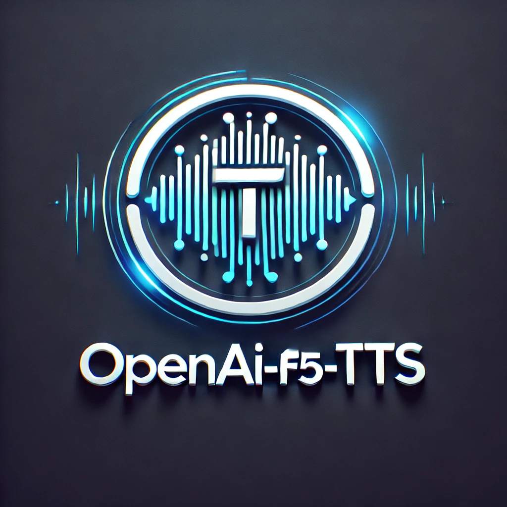
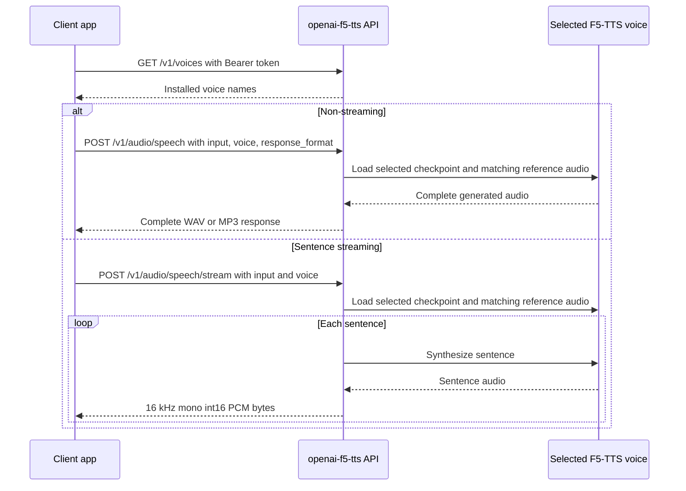

# openai-f5-tts



**Release status: SOHO-oriented community beta, verified on one machine (20 October 2026).** This independently developed API wrapper exposes upstream F5-TTS through an OpenAI-style speech route, sentence streaming, voice discovery and estimated timestamps. Real NVIDIA GPU inference was verified in Docker Desktop with installed v0 and v1 checkpoints. Use sequential requests on a trusted system; model-backed simultaneous streaming, model-backed CPU inference and cold dependency installation remain unverified; newer synthetic native tests are described below. This project is not affiliated with OpenAI or the upstream F5-TTS authors. See the [verification report](docs/verification-2026-10-20.md).

---

## Table of Contents

- [Client apps and multiple voices](#client-apps-and-multiple-voices)
- [Prerequisites](#prerequisites)
- [Deployment Instructions](#deployment-instructions)
  - [Using Docker Compose (Experimental Local Preview)](#using-docker-compose-experimental-local-preview)
- [Development Setup](#development-setup)
  - [Prerequisites](#prerequisites-1)
  - [Installation Steps](#installation-steps)
- [API Endpoints](#api-endpoints)
  - [POST /v1/audio/speech](#v1audiospeech)
  - [POST /v1/audio/speech/stream](#v1audiospeechstream)
  - [GET /v1/models](#v1models)
  - [GET /v1/voices](#v1voices)
  - [POST /v1/text-to-speech/{voice}/with-timestamps](#v1text-to-speechvoicewith-timestamps)
  - [GET /v1/voices/all](#v1voicesall)
  - [GET /v1/loaded_models](#v1loaded_models)
- [Streaming Test Client](#streaming-test-client)
- [Adding Your Own Fine-Tuned Checkpoint](#adding-your-own-fine-tuned-checkpoint)
- [TODO](#todo)
- [Support](#support)
- [Contributing](#contributing)
- [License](#license)

---

## Client apps and multiple voices

Client apps send authenticated HTTP requests to the API. Use the published host
port: the repository default is `http://127.0.0.1:9090`; the verified local setup
uses port `9091`. A Docker client on the same Compose network can use `http://app:9090`.



This uses GitHub-supported Mermaid sequence-diagram syntax. Every request in the
diagram requires `Authorization: Bearer <API_KEY>` when authentication is enabled.
The streaming client needs PCM playback support; this route sends chunked HTTP
audio rather than an MP3 file or server-sent events.

**Multiple voices are selectable per request in all three speech modes.** Each installed voice
needs a checkpoint directory under `ckpts/<voice>/` and matching reference audio
under `ref_audio/<voice>.<extension>`. Discover names with `GET /v1/voices`, then
send the chosen name in the `voice` field.

The verification report references **Scarlett**, the author's privately trained
model. It was used for local testing and **is not distributed or offered for
download**. Its mention does not make it an available voice on another installation.
Public examples below use Emilia, which requires the separately downloaded upstream
checkpoint and matching reference audio described in the setup instructions.

| Mode | Endpoint | JSON body |
|---|---|---|
| Complete audio file | `POST /v1/audio/speech` | `{"input":"Hello from Emilia.","voice":"Emilia","response_format":"mp3"}` |
| Sentence streaming | `POST /v1/audio/speech/stream` | `{"input":"Hello from Emilia. This is the next sentence.","voice":"Emilia"}` |
| Estimated timestamps | `POST /v1/text-to-speech/Emilia/with-timestamps` | `{"text":"Hello from Emilia."}` |

Any correctly configured installed voice can be used with all three speech endpoints.
For timestamps, the voice is selected in the URL path rather than the JSON body.

`MODEL_LOAD_LIMIT` controls how many checkpoints remain loaded, **not** how many
voices can be installed or selected. Its default is `1`: switching voices evicts
the previous checkpoint and loads the requested one. A larger limit can keep more
voices warm if GPU memory permits, but does not enable safe simultaneous synthesis.
Whisper, the vocoder and inference workspace also use memory.

Use one synthesis request at a time across all three speech modes. Ordinary, timestamped and
streaming synthesis share a process-local generation gate; competing requests
return HTTP 503. Streaming keeps its lease through delivery and closes it on a
WSGI response close or disconnect (synthetic regression verified). This is **not**
a multi-process or distributed GPU lock. For parallel voice jobs, use an application
queue or isolated service instances with separately managed model caches.

## Current implementation and limitations

- `POST /v1/audio/speech` generates audio using an installed F5-TTS checkpoint, a matching reference-audio file and a locally loaded Whisper transcription model. The documented `speed` parameter reaches the inference call; supported conversions use FFmpeg.
- `GET /v1/models`, `GET /v1/voices`, `GET /v1/voices/all` and `GET /v1/loaded_models` are authenticated. Voice language metadata is **not** implemented; `/v1/voices?language=...` or `?locale=...` currently returns an empty `voices` list for nonempty filters, not a working language-filtered result.
- `POST /v1/text-to-speech/{voice}/with-timestamps` returns base64 audio and, where duration can be read, **duration-weighted estimated timings**, *not* forced alignment. Null alignment is possible.
- Sentence streaming is implemented on `main` at `POST /v1/audio/speech/stream`, with one synthesized sentence sent at a time as 16 kHz mono signed int16 little-endian PCM **by default**, or network-order big-endian when `Accept: audio/L16` is explicitly requested. Historical little-endian streaming was verified with real GPU inference; see the [verification report](docs/verification-2026-10-20.md).
- The Compose setup currently requires NVIDIA GPU container support and mounts local checkpoint and reference-audio folders. The installer pulls an **unpinned** upstream F5-TTS dependency; reproducible builds have not been demonstrated.
- **Checkpoint path-trust guard (source-only verified):** discovery now checks that the configured checkpoint root and its ancestors are not symlinks, and that voice directories and selected `.safetensors` files are real directories / singly linked regular files, not symlinks or hardlinks. Immediately before loading a previously discovered voice, the path is checked again **before any loaded model is evicted**. A stale or substituted path fails without invoking the model loader. Keep the checkpoint tree trusted and immutable to less-privileged writers: pathname checks cannot eliminate **replacement races** between validation and the upstream loader opening the file. This does **not** prove file authenticity, content format, signature, integrity, permission confinement or licensing. Checkpoint-substitution attacks during live inference and Windows-native path behavior remain unverified; ordinary Docker inference is covered by the verification report.
- **Checkpoint loading is native-safetensors-only.** The wrapper discovers `model_1250000.safetensors` first, or `model_1200000.safetensors`; it does **not** deserialize or automatically convert legacy pickle-based `.pt` files. Users with only `.pt` checkpoints must obtain a genuine `.safetensors` export from a trusted offline training/export environment before using this branch. Do not simply rename a `.pt` file.
- Incoming JSON request bodies are bounded by `MAX_REQUEST_BYTES` (default 65536). **All three speech endpoints** additionally enforce `MAX_TEXT_CHARS` (default 2000), voice names of at most 128 characters and finite speed from 0.25 to 4 inclusive. The **process-local, non-blocking single-generation gate** covers ordinary, timestamped and streaming synthesis (including active stream delivery), returning HTTP **503** on contention. A stream releases its lease on completion, disconnect, pre-header failure or WSGI response close even before body iteration (synthetic offline tested). This is not a cross-process or cluster-wide limit. Wrapper HTTP/body/credential debug logging has been removed and Gevent request/exception access logging is configured off. Direct Python `print` output in the imported upstream F5-TTS inference module is discarded by a module-local print override, including its known reference-text, generated-text and checkpoint-path statements. This does not sanitize native file-descriptor writes, third-party logger handlers, future upstream changes or fronting reverse-proxy logs; those require separate operational controls and review after dependency updates.
- The Python wrapper is MIT-licensed. **Upstream pretrained F5-TTS model weights are CC-BY-NC** per [SWivid/F5-TTS licensing](https://github.com/SWivid/F5-TTS#license); this repository's MIT license does not grant commercial rights to those weights. Check any reference-audio and voice rights separately.


### Reference-audio and cache pathname trust

- **Reference-audio file trust (source-only guarded):** `get_ref_audio_path` validates a one-segment voice name and a non-symlinked reference-audio root (including ancestors), and accepts only singly linked regular input files with supported extensions. It rejects symlink and hardlink inputs rather than following them. Before FFmpeg writes or reads, cached WAV/PCM paths are checked for real singly linked regular files under a non-symlinked cache root; dangling symlinks, directories and unexpected paths are rejected. Pre-existing intermediate `<voice>_processed.pcm` files now fail closed rather than being clobbered or deleted; an operator must inspect/remove stale files separately in their trusted private workspace. The cached WAV is rechecked before decoding/resampling, and before Whisper reads it. Directory owners must keep `ref_audio/`, `ref_audio_cache/` and their ancestors private to trusted writers. **Metadata checks are not race-free:** a concurrent pathname swap before FFmpeg/Whisper opens the path can defeat these checks. Neither extension nor metadata validation proves audio content, consent, integrity, or provenance, or sandboxes FFmpeg. No live FFmpeg, Whisper or model execution was performed during the 14 October source review; the normal execution path was subsequently verified on 20 October as described in the verification report.

### Bounded output buffering and FFmpeg safeguards

- `MAX_AUDIO_OUTPUT_BYTES` (positive integer, default **16777216 = 16 MiB**) bounds each file read by **limit + 1 byte** in both `/v1/audio/speech` and the timestamped base64 route. Oversized generated output returns HTTP **503** with `Generated audio exceeds configured output limit`; the request-owned output file is removed. The size check happens **after** synthesis and encoding, so it does not prevent large intermediate audio allocations or disk writes. Even an accepted timestamped response expands during base64 encoding and JSON serialization; aggregate request memory is not independently bounded.
- `FFMPEG_TIMEOUT_SECONDS` (positive integer, default **120**) applies separately to all **four** FFmpeg call sites: three reference-audio preparation stages and one final audio conversion. FFmpeg is invoked with `-nostdin -hide_banner -loglevel error -nostats`. On reference conversion failure or timeout, incomplete cached WAV and intermediate PCM files are discarded so a later request can retry. A request whose final encoding fails uses the existing per-request audio cleanup; a model inference stall is **not** bounded by the FFmpeg timeout.
- These are **source-level mitigations**, verified through deterministic mocked file/subprocess and real Flask test-client regressions, **not** runtime guarantees for GPU memory, total disk usage, concurrent HTTP responses, native-library termination or multi-worker deployments. No model load, real FFmpeg or container startup was performed during that earlier source review; see the verification report for the subsequent model-backed Docker checks.

### Model-cache recovery and authentication contract

- The model cache is a **bounded in-process LRU**, not persistent storage. A voice switch may evict the least recently used model *before* allocating the next model to limit peak memory; if a new checkpoint fails to load, the evicted model is **not automatically restored**. A later authorized request can reload it from disk. Never interpret discovery or a `loaded` flag as successful speech generation.
- A failed load must leave **no partially registered model** in `loaded_models`. `MODEL_LOAD_LIMIT` must be a positive integer; a bad configuration should fail during startup instead of failing mid-request.
- On a failed checkpoint load (including a `None` result), the handler now attempts **best-effort** Python garbage collection and CUDA allocator cache release before re-raising the *original* error. Cleanup errors cannot hide that loading failure. The evicted voice is **not automatically restored**; subsequent authorized requests can retry. Synthetic CPU/CUDA mocks cover failure, retry and secondary cleanup exceptions, but **no live GPU memory-recovery guarantee exists**.
- The published `/v1/models`, `/v1/voices`, `/v1/voices/all`, `/v1/loaded_models`, `/v1/audio/speech`, `/v1/audio/speech/stream`, and `/v1/text-to-speech/{voice}/with-timestamps` routes require `Authorization: Bearer <key>` or `xi-api-key: <key>` when `REQUIRE_API_KEY=True`. Missing or invalid keys should return **401**, including malformed/non-ASCII token values; no secret should be echoed into logs or responses.
- When `REQUIRE_API_KEY=True` (default), a non-placeholder API key is **required at import/startup** and all 7 HTTP routes enforce Bearer or `xi-api-key` authentication. Setting `REQUIRE_API_KEY=False` is intended **only** for explicit numeric loopback binding (`HOST=127.0.0.1` / `--host 127.0.0.1`, or `::1` on IPv6). A wildcard `0.0.0.0` / `::`, LAN IP, DNS hostname including `localhost`, or any ambiguous address must cause a startup error **before** TTS handler construction. This is a process bind safeguard, not reverse-proxy or host-network isolation; do not expose unauthenticated mode beyond your own machine.
- The offline Flask test-client suite exercises the **actual Flask routes and authentication decorator** while replacing Gevent and model startup with inert fixtures. It verifies Bearer and `xi-api-key` headers, missing/invalid/non-ASCII key rejection (401), explicit optional authentication bypass **without an API key**, enabled-mode placeholder-key rejection, invalid bodies (400), oversized bodies (413) and synthetic busy responses (503). The fixture's busy exception is tied to the same class imported by the server, eliminating a standalone-versus-full-suite import-order false failure. No socket or inference is used; production reverse-proxy behavior remains unverified.

### Concurrency and temporary-file status

Ordinary synthesis, timestamp requests and streaming share one process-local generation gate; use sequential requests across all synthesis endpoints unless you explicitly handle 503 contention. A separate request-owned encoder removes partial WAV/converted files after success or failure; deterministic mock-backed regressions exercise both paths. The Python server still has **no cross-process admission mechanism**, no proved scheduling fairness and no model-backed concurrent load measurements. Avoid multiple workers or exposing the API on untrusted networks until an independent release review.

## Prerequisites

Before getting started, ensure you have the following installed on your system:

- **Git**: For cloning the repository.
- **Docker with NVIDIA GPU support**: Required for the existing GPU-focused Compose configuration. The local Docker Desktop deployment was verified on 20 October 2026; cold dependency installation remains unverified.
  - **Linux Users**: Tested with `docker.io` on Ubuntu 24.04 LTS.
  - **Windows Users**: Tested with Docker Desktop on Windows 11 (using WSL2 backend).
- **Python 3.10**: Required for development setup.
- **Conda** (optional but recommended for creating an isolated Python environment).

---

## Deployment Instructions

### Using Docker Compose (Experimental Local Preview)

This Compose configuration packages the Flask application and its dependencies. A rebuild using cached dependencies passed real GPU speech tests on 20 October 2026. A cold dependency installation remains unverified. Prepare a checkpoint and matching reference audio before starting the service; see the verification report for the exact tested scope.

**Step 1: Ensure Docker is Installed**

Make sure Docker is installed on your system. You can download Docker from [Docker's official website](https://www.docker.com/get-started).

**Step 2: Clone the Repository**

```bash
git clone https://github.com/matthewhand/openai-f5-tts
cd openai-f5-tts
```

**Step 3: Prepare a licensed F5-TTS v1 checkpoint (large download)**

The original instructions cloned the whole multi-gigabyte Hugging Face model repository. This application only needs the **v1 Base** checkpoint in a folder matching the voice name. The upstream publisher identifies `F5TTS_v1_Base/model_1250000.safetensors` as the v1 model; the file is approximately **1.35 GB**, is stored using Git LFS/Xet and is licensed **CC-BY-NC-4.0**. This download is optional and **has not been performed or runtime-tested during this review**.

Choose an approved source and confirm you accept the model's license before downloading. The following pinned file and checksum are published by [SWivid on Hugging Face](https://huggingface.co/SWivid/F5-TTS/blob/d6bd6c3c3ec65c0a3ef25a6d3d09658c5e2817fd/F5TTS_v1_Base/model_1250000.safetensors):

- Source revision: `d6bd6c3c3ec65c0a3ef25a6d3d09658c5e2817fd`
- Expected SHA-256: `670900fd14e6c458b95da6e9ed317cdb20dbaf7a1c02ac06a05475a9d32b6a38`
- Destination: `ckpts/Emilia/model_1250000.safetensors`

**Linux (example commands; not executed):**

```bash
mkdir -p ckpts/Emilia ref_audio
curl -fL --retry 3 -o ckpts/Emilia/model_1250000.safetensors \
  https://huggingface.co/SWivid/F5-TTS/resolve/d6bd6c3c3ec65c0a3ef25a6d3d09658c5e2817fd/F5TTS_v1_Base/model_1250000.safetensors
echo "670900fd14e6c458b95da6e9ed317cdb20dbaf7a1c02ac06a05475a9d32b6a38  ckpts/Emilia/model_1250000.safetensors" | sha256sum -c -
curl -fL -o ref_audio/Emilia.wav \
  https://github.com/SWivid/F5-TTS/raw/refs/heads/main/src/f5_tts/infer/examples/basic/basic_ref_en.wav
```

**Windows PowerShell (example commands; not executed):**

```powershell
New-Item -ItemType Directory -Force ckpts/Emilia, ref_audio | Out-Null
curl.exe -fL -o ckpts/Emilia/model_1250000.safetensors "https://huggingface.co/SWivid/F5-TTS/resolve/d6bd6c3c3ec65c0a3ef25a6d3d09658c5e2817fd/F5TTS_v1_Base/model_1250000.safetensors"
(Get-FileHash ckpts/Emilia/model_1250000.safetensors -Algorithm SHA256).Hash
# Compare the output to the SHA-256 above; do not proceed if it differs.
curl.exe -fL -o ref_audio/Emilia.wav "https://github.com/SWivid/F5-TTS/raw/refs/heads/main/src/f5_tts/infer/examples/basic/basic_ref_en.wav"
```

On macOS, use `shasum -a 256 ckpts/Emilia/model_1250000.safetensors` and compare the printed digest with the expected SHA-256 above; `sha256sum` is generally not preinstalled. The *example* reference audio comes from the upstream project and remains subject to its own rights. You may instead supply appropriately licensed/consented audio as `ref_audio/Emilia.wav`. The reference-audio URL above is not pinned; verify source integrity before relying on it in production. Never use untrusted pickle-based `.pt` checkpoints.

**Before running:** `.env.example` contains the nonfunctional placeholder `API_KEY=your_api_key_here`. Replace it with a strong private secret, and set `DEFAULT_VOICE=Emilia` to match the model folder you actually populated. Never commit `.env`. Docker Compose now publishes port 9090 **only on host loopback** (`127.0.0.1:9090`). Do not forward this port externally.

**Step 4: Set Up Environment Variables**

Copy `.env.example` to `.env` and update it as needed:

- **Linux/macOS:**

  ```bash
  cp .env.example .env
  ```

- **Windows (Command Prompt and PowerShell):**

  ```cmd
  copy .env.example .env
  ```

**Key Environment Variables:**

- `API_KEY`: Set this to secure API access.
- `PORT`: The server port defaults to `9090`. The supplied Compose file explicitly sets it to `9090` regardless of an alternate value in `.env`.
- `REQUIRE_API_KEY`: Keep `True` (default) to enforce API key authentication. With `True`, supply a non-placeholder `API_KEY`. Setting `False` disables authentication and permits startup without a key **only if the server bind is an explicit numeric loopback IP**: set `HOST=127.0.0.1` or pass `--host 127.0.0.1`. The container normally listens on `0.0.0.0` internally, so **Compose must not start in unauthenticated mode**, even though its published host port is currently loopback. `localhost` hostnames are intentionally rejected when authentication is disabled.
- `DEFAULT_VOICE`: Set explicitly to the exact directory name under `ckpts/` (for this walkthrough: `Emilia`). The current Compose default is also `Emilia`; its checkpoint and `ref_audio/Emilia.wav` must exist. Reference audio is selected automatically as `ref_audio/<voice>` plus a supported extension; `REF_AUDIO_PATH` is not read by the API.
- `DEFAULT_RESPONSE_FORMAT`: Output audio format (e.g., `mp3`).

**Step 5: Run the Application**

Use Docker Compose to build and start the service:

```bash
docker compose up --build -d
```

*This command may take several minutes to complete, especially the first time as Docker downloads the necessary images.*

Compose starts the API directly. An authenticated model-list response does not establish successful synthesis: test an actual speech request. This configuration requires NVIDIA GPU support and may download the large Whisper model at first startup.

**Step 6: Access the API**

The API will be available at `http://localhost:9090` by default.

**Step 7: Manage the Service**

- **Stop the service:**

  ```bash
  docker compose down
  ```

- **Restart the service:**

  ```bash
  docker compose up -d
  ```

**Step 8: Confirm Service is Operational**

Use `curl` to verify that the service is running correctly and that the "Emilia" voice model is available:

```bash
curl -H "Authorization: Bearer <YOUR_REAL_API_KEY>" http://127.0.0.1:9090/v1/models
```

You should see a `models` list if initialization succeeds. Follow it with a real audio request using an installed voice; discovery alone is not proof of successful synthesis.

---

## Development Setup

If you are developing or contributing to this project, the following method allows for a more flexible setup.

### Prerequisites

- **Python 3.10**: Ensure Python 3.10 is installed on your system.
- **Conda** (recommended) or `venv` for creating an isolated Python environment.

*Note for Windows Users:* If `conda` commands are unavailable, install [Anaconda](https://www.anaconda.com/products/distribution) and use the Anaconda Prompt or Anaconda PowerShell.

### Installation Steps

**Step 1: Clone the Repository**

```bash
git clone https://github.com/matthewhand/openai-f5-tts
cd openai-f5-tts
```

**Step 2: Prepare the same checkpoint and reference audio**

Follow the pinned **F5-TTS v1** model instructions in the [Docker installation section](#using-docker-compose-experimental-local-preview), including license review and SHA-256 verification. The development and Docker paths use the same `ckpts/Emilia/` and `ref_audio/Emilia.wav` layout. Do not clone an entire model repository unnecessarily.

**Step 3: Create a Python Environment**

Set up a Python 3.10 environment using Conda or virtual environments:

- **Using Conda:**

  ```bash
  conda create -n f5-tts python=3.10
  conda activate f5-tts
  ```

  *Note for Windows Users:* If `conda` commands are unavailable, install [Anaconda](https://www.anaconda.com/products/distribution) and use the Anaconda Prompt or Anaconda PowerShell.

- **Using `venv`:**

  ```bash
  python3.10 -m venv f5-tts
  source f5-tts/bin/activate  # On Windows: f5-tts\Scripts\activate
  ```

**Step 4: Install PyTorch and Torchaudio**

Install PyTorch and Torchaudio with CUDA support (adjust for your CUDA version if necessary):

```bash
pip install torch==2.3.0+cu118 torchaudio==2.3.0+cu118 --extra-index-url https://download.pytorch.org/whl/cu118
```

*Note:* Ensure your system has the appropriate CUDA version installed for GPU acceleration. If you do not have CUDA, you can install the CPU-only versions:

```bash
pip install torch==2.3.0+cpu torchaudio==2.3.0+cpu --extra-index-url https://download.pytorch.org/whl/cpu
```

**Step 5: Install Project Dependencies**

Install the required Python packages:

```bash
pip install -r requirements.txt
```

**Step 6: Set Up Environment Variables**

Copy `.env.example` to `.env` and update the variables as needed:

- **Linux/macOS:**

  ```bash
  cp .env.example .env
  ```

- **Windows (Command Prompt/PowerShell):**

  ```cmd
  copy .env.example .env
  ```

**Step 7: Run the Application**

Start the Flask server locally:

```bash
python app/server.py --host 127.0.0.1
```

With this explicit loopback bind, the API will be accessible at `http://127.0.0.1:9090`. Without `--host` or `HOST`, the Python server defaults to binding `0.0.0.0` when authentication is enabled; do not use that default for a local-only preview.

---

## API Endpoints

**Busy behavior:** all three synthesis endpoints return HTTP `503` and `{"error": "Speech generator busy; try again later"}` if another request already owns the single local generation slot. Non-speech list endpoints are unaffected. This behavior is only process-local.

### `/v1/audio/speech`

Primary route for generating speech from text input. With the default `REQUIRE_API_KEY=True`, supply a Bearer token or an `xi-api-key` header. Authentication can be disabled only with an explicit numeric loopback bind as explained above.

- **Method**: `POST`
- **Headers**: `Authorization: Bearer <API_KEY>`
- **Data (JSON)**:
  - `input` (string): The text to convert to speech.
  - `voice` (string, optional): Discovered voice name; defaults to `DEFAULT_VOICE` (`Emilia` unless configured otherwise).
  - `response_format` (string, optional): `mp3`, `wav`, `flac`, `aac`, `opus` or `pcm`; defaults to `DEFAULT_RESPONSE_FORMAT` (`mp3` unless configured otherwise).
  - `speed` (number, optional): Between `0.25` and `4` inclusive; defaults to `DEFAULT_SPEED` (`1.0` unless configured otherwise).
  - `ref_audio`: **Not implemented as a per-request override.** Reference audio is resolved from the voice name under `ref_audio/`; omitting this field is recommended.

- **Response**: An audio file in the specified format. For `pcm` the payload is raw little-endian signed 16-bit PCM (`application/octet-stream`, `X-Audio-Encoding: s16le`); the non-streaming sample rate follows the inference output rather than a guaranteed 16 kHz. The raw payload has no container or sample-rate metadata.

**Example:**

```bash
curl -X POST http://localhost:9090/v1/audio/speech \
     -H "Authorization: Bearer <API_KEY>" \
     -H "Content-Type: application/json" \
     -d '{"input": "Hello world", "voice": "Emilia", "response_format": "mp3"}' \
     > output.mp3
```

---

### `/v1/audio/speech/stream`

Streams speech as raw **int16 PCM at 16 kHz** using chunked transfer encoding. Designed for real-time voice agent pipelines (e.g. Hugging Face speech-to-speech).

The input text is split into sentences by a small built-in splitter (no NLTK and no runtime downloads; it handles abbreviations like "Dr." and Chinese punctuation). Each sentence is synthesised by F5-TTS and flushed to the client immediately, so playback can begin before the full response is ready. Dropping the HTTP connection mid-stream stops further synthesis — useful for barge-in handling.

- **Method**: `POST`
- **Headers**: `Authorization: Bearer <API_KEY>`
- **Body (JSON)**:
  - `input` (string): Text to synthesise.
  - `voice` (string, optional): Voice model to use (default: `Emilia`).
  - `speed` (float, optional): Speed factor (default: `1.0`).
- **Response**:
  - **Default:** `Content-Type: application/octet-stream`, `X-Audio-Encoding: s16le`.
  - **Explicit opt-in:** send `Accept: audio/L16` to receive network-order big-endian L16 and `Content-Type: audio/L16; rate=16000; channels=1`, `X-Audio-Encoding: s16be`.
  - Both modes: `X-Sample-Rate: 16000`, `X-Audio-Channels: 1`.
  - Body: raw signed int16 PCM, one chunk per sentence, with the requested byte order.

**Migration from the historic stream:** The earlier response advertised `audio/L16` while actually sending little-endian PCM. The default body bytes are unchanged; only its MIME/encoding headers are corrected. Clients relying on the *old MIME label* must update their header handling. Wildcard `Accept: */*` does **not** request big-endian; only an explicit positive `audio/L16` media range does. Clients that want L16 must decode big-endian samples or convert them to little-endian before creating a WAV file. `scripts/stream_client.py --l16` demonstrates this; without the flag it retains default legacy-byte playback.

```bash
curl -X POST http://localhost:9090/v1/audio/speech/stream \
     -H "Authorization: Bearer <API_KEY>" \
     -H "Content-Type: application/json" \
     -d '{"input": "Hello. This streams sentence by sentence.", "voice": "Emilia"}' \
     > output.pcm
```

To request network-order L16 explicitly instead of the default little-endian PCM, add `-H "Accept: audio/L16"` to the streaming `curl` command above and save the bytes as `output.l16`. Decode those samples as **big-endian signed 16-bit**; do not treat the raw file as a WAV container.

> **Note**: Full per-sentence inference is required before each sentence can be sent. First-audio latency includes model loading and reference processing when needed. The local two-sentence checks observed first audio at 2.813 seconds for Scarlett and 14.812 seconds for the initial Emilia stream; these are individual observations, not latency guarantees.

### `/v1/models`

Lists available TTS models.

- **URL**: `/v1/models`
- **Method**: `GET`
- **Headers**: `Authorization: Bearer <API_KEY>`
- **Response**: JSON containing the available models.

### `/v1/voices`

Lists names of discovered voices. Language metadata and actual language filtering are **not implemented**.

- **URL**: `/v1/voices`
- **Method**: `GET`
- **Headers**: `Authorization: Bearer <API_KEY>`
- **Parameters**:
  - `language` or `locale` (optional): Accepted by the route, but a nonempty filter currently returns `{"voices": []}` because discovered model records have no language metadata. Omit it to list all discovered voice names.
- **Response**: JSON containing a `voices` array of names.

### `/v1/text-to-speech/{voice}/with-timestamps`

Optional ElevenLabs-shaped route (not a promise of ElevenLabs interoperability): authenticated POST with `{"text":"Hello"}` (or `input`), and the voice in the URL. The response contains `audio_base64`, `alignment`, `normalized_alignment`, `words` and `alignment_source`. Timing is either `duration_weighted` estimated from text and audio duration, or `unavailable` with null alignment. **No forced aligner is currently connected**, even if WhisperX is installed.

**Timestamp audio output formats:** `output_format` query parameter takes priority over body `response_format`. The legacy names `mp3_44100_128`, `ogg_48000_128` and `wav_44100_128` remain accepted **as codec selectors only** (MP3, Ogg/Opus and WAV, respectively); their numerical suffixes do not enforce sample rate or bitrate. Use the explicit opt-in strict names below for enforced encoder settings:

| Strict output_format | Encoder contract |
|---|---|
| `mp3_44100_128_strict` | MP3, 44.1 kHz mono, 128 kbps nominal CBR |
| `ogg_48000_128_strict` | Ogg Opus, 48 kHz mono, 128 kbps constant codec target (container overhead excluded) |
| `wav_44100_pcm16_strict` | WAV, 44.1 kHz mono signed PCM16; uncompressed audio is 705.6 kbps, not 128 kbps |

For an enforced MP3 profile, use `POST /v1/text-to-speech/Emilia/with-timestamps?output_format=mp3_44100_128_strict` with `Content-Type: application/json`, `Authorization: Bearer <API_KEY>` and a body such as `{"text":"Hello from Emilia."}`. The JSON `audio_base64` contains the encoded audio, not raw PCM; the response includes `encoding_profile` for strict requests.

The strict names add an `encoding_profile` field to the timestamp response. Unknown strict aliases return HTTP 400. Exact measured container bitrate can differ from encoder nominal bitrate; use media inspection for verification. Ordinary `mp3`, `wav`, `ogg` etc. and existing legacy aliases retain their previous behavior; no implicit profile change is performed.

### `/v1/voices/all`

Lists all supported voices, regardless of language.

- **URL**: `/v1/voices/all`
- **Method**: `GET`
- **Headers**: `Authorization: Bearer <API_KEY>`
- **Response**: JSON containing all supported voices.

---

### `/v1/loaded_models`

Reports names of voice models currently present in the in-process model cache, not proof that they have produced audio. Authenticated `GET`; response is JSON with a `loaded_models` array. Cache contents can change after voice switches.

## Streaming Test Client

`scripts/stream_client.py` (standard library only) hits the streaming endpoint and writes the received PCM to a WAV file for verification.

```bash
python scripts/stream_client.py \
  --text "Hello. The quick brown fox jumps over the lazy dog. Streaming works." \
  --voice Emilia \
  --output stream_test.wav
```

Options:

| Flag | Default | Description |
|------|---------|-------------|
| `--host` | `localhost` | Server hostname |
| `--port` | `9090` | Server port |
| `--api-key` | `$API_KEY` env var | Bearer token |
| `--voice` | `$DEFAULT_VOICE` env var | Voice name |
| `--speed` | `1.0` | Speed factor |
| `--text` | built-in sample | Text to synthesise |
| `--output` | `stream_test_output.wav` | Output WAV path |

---

## Adding Your Own Fine-Tuned Checkpoint

Enhance the TTS system by adding your own fine-tuned voice model. Follow these steps:

> **v0 vs v1 checkpoints.** F5-TTS v0 checkpoints (`model_1200000.*`) need different model flags than v1 (`model_1250000.*`); loading one with the other's settings gives babble rather than an error. The server picks the config from the filename. For anything else, put a `model_config.json` next to the checkpoint, e.g. `{"text_mask_padding": false, "pe_attn_head": 1}` (merged over the v1 defaults).

**Step 1: Create a Directory for Your Voice Model**

- **Linux/macOS:**

  ```bash
  mkdir -p ckpts/MyVoice
  ```

- **Windows (Command Prompt/PowerShell):**

  ```powershell
  mkdir ckpts\MyVoice
  ```

**Step 2: Add the Model File**

Use a trusted **native safetensors export** of your fine-tuning checkpoint named `model_1200000.safetensors` (or `model_1250000.safetensors`). The service no longer discovers `.pt` files and **does not** convert them automatically; obtain the export separately in your trusted training environment. Changing the extension of a `.pt` file is not a conversion. Never load an untrusted pickle checkpoint merely to export it.

- **Linux/macOS:**

  ```bash
  mv path_to_your_checkpoint/model_1200000.safetensors ckpts/MyVoice/
  ```

- **Windows (Command Prompt/PowerShell):**

  ```powershell
  move path_to_your_checkpoint\model_1200000.safetensors ckpts\MyVoice\
  ```

**Step 3: Add Reference Audio**

Add a reference audio file in the `ref_audio/` directory:

- **Linux/macOS:**

  ```bash
  mv path_to_ref_audio/MyVoice.wav ref_audio/
  ```

- **Windows (Command Prompt/PowerShell):**

  ```powershell
  move path_to_ref_audio\MyVoice.wav ref_audio\
  ```

**Step 4: Verify the checkpoint format**

Confirm you have a regular file under `ckpts/MyVoice/` ending in `.safetensors`, not merely a renamed `.pt` file. No automatic `.pt` conversion occurs. Checkpoints must be trusted and licensed; the extension check is **not** a guarantee that an arbitrary model file is safe or functional. The verification report covers the installed local models; validate your own checkpoint and reference audio with a real speech request before relying on them.

**Step 5: Use the New Voice**

Specify your new voice in API calls:

```bash
curl -X POST http://localhost:9090/v1/audio/speech \
     -H "Authorization: Bearer <API_KEY>" \
     -H "Content-Type: application/json" \
     -d '{
           "input": "Hello world",
           "voice": "MyVoice",
           "response_format": "mp3",
           "speed": 1.0
         }' > output.mp3
```

---

## TODO

- [x] Expose an OpenAI-style `/v1/audio/speech` endpoint (not full OpenAI API compatibility)
- [x] Verify real GPU speech in Docker Desktop with installed v0/v1 checkpoints, non-streaming audio and sentence streaming; cold dependency installation remains unverified
- [x] Multiple voice models
- [x] Streaming endpoint for real-time voice agent pipelines
- [ ] Add expression parsing for nuanced speech
- [x] Document the checkpoint filename discovery rules (see below); independently verify the setup with licensed checkpoints before declaring this complete
- [ ] Enhance error handling and logging

---

## Local offline regression checks

Without downloading models, building containers or contacting external services, run these source/mock checks from the repository root:

```bash
python -m unittest discover -s tests -p 'test_request_validation.py' -v
python -m unittest discover -s tests -p 'test_cli.py' -v
python -m unittest discover -s tests -p 'test_source_contract.py' -v
python -m unittest discover -s tests -p 'test_model_cache_failure.py' -v
python -m unittest discover -s tests -p 'test_flask_auth_integration.py' -v
python -m unittest discover -s tests -p 'test_output_limits.py' -v
python -m unittest discover -s tests -p 'test_reference_ffmpeg_timeout.py' -v
```

Run all local low-load synthetic regressions with `PYTHONDONTWRITEBYTECODE=1 python -m unittest discover -s tests -p 'test_*.py' -v` (110 tests passed in an isolated source-only workspace on 14 October 2026, including reference-audio and cache symlink/hardlink/path-swap regressions, checkpoint path-trust checks, startup-binding and real-Flask tests; no models, real FFmpeg or inference). These cover pure input validation, mock CLI behavior, generation admission, bounded HTTP audio reads and oversize 503 responses, fake FFmpeg timeouts and reference-cache cleanup, source contracts, **real Flask test-client authentication**, and AST-extracted cache-load/eviction recovery. The Flask integration suite skips when Flask is not already installed; no package installation is needed for the other tests. The startup-binding checks use real Flask imports with inert Gevent and model fixtures; they never open a socket. No actual FFmpeg binary, real model loading/inference, working Docker build, reverse proxy or synthesized audio was validated. No GitHub Actions workflows exist in this repository and this project is not configured to run hosted CI.

**Newer acceptance evidence (28 October 2026, merged PR #24):** an isolated disposable environment with real Gevent and CPU-only Torch ran `223 passed, 197 subtests` with zero skips. This included synthetic model-boundary tests, real CPU Torch streaming lifecycle checks, a fictional loopback Gevent request/access-log privacy check and offline FFmpeg format tests. No pretrained weights, live synthesis, hosted CI or deployment were used. This result does **not** establish CPU model-backed inference, real concurrent GPU behavior, fully sanitized upstream/native logs, a reproducible cold build or a reverse-proxy privacy guarantee. See issues #20 and #21 for remaining verification and dependency reproducibility. The dated 14 October source-only result and 20 October Docker GPU verification report above are separate historical evidence, not replaced by this suite.

To rerun the full current suite when `pytest`, Flask and optional native test dependencies are installed locally, without model downloads or external HTTP requests:

```bash
HF_HUB_OFFLINE=1 TRANSFORMERS_OFFLINE=1 WANDB_MODE=disabled PYTHONDONTWRITEBYTECODE=1 PYTEST_DISABLE_PLUGIN_AUTOLOAD=1 python -B -m pytest -q -rs -p no:cacheprovider tests
```

Native Gevent privacy coverage sends **one fictional HTTP request to loopback only**; the source/mock tests above do not contact external services. On a lightweight environment lacking Gevent or Torch, dependency-dependent native tests may skip and must not be counted as native acceptance. Full model-backed inference requires separately licensed model assets and independent verification.

The optional CLI launcher is `python f5_tts_app/cli.py --host 127.0.0.1 --port 9090`; it launches the same API server and therefore still needs all models and dependencies installed.

## Support

If you encounter any issues or have questions, feel free to open an issue on the [GitHub repository](https://github.com/matthewhand/openai-f5-tts). Include the API route, error and local environment but **never** API keys, private reference audio or generated text.

---

## Contributing

Contributions are welcome through a focused issue or pull request. There is no published `CONTRIBUTING.md` yet; use this README as the current source of supported behavior.

---

## License

The **wrapper code** is licensed under the [MIT License](LICENSE). **Pretrained F5-TTS model weights are separately licensed CC-BY-NC** by their upstream publisher; commercial use is not granted by this repository's MIT license. Validate the terms of any additional checkpoints and reference audio you supply.

---

Thank you for using **openai-f5-tts**! We hope it helps bring your projects to life with natural and customizable speech synthesis.
